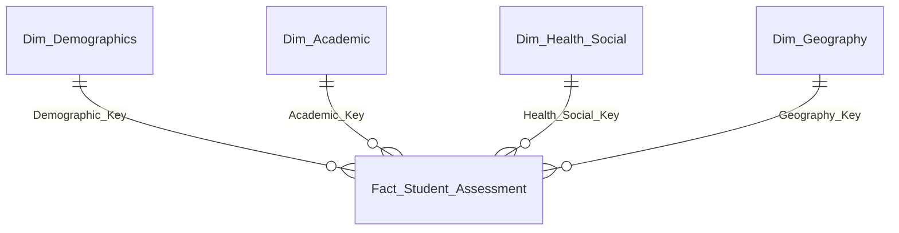

# 📊 Project 1: Student Depression Analytics & Risk Early-Warning Suite


-green)

## 📌 Executive Summary & Problem Statement
University student mental health is a growing global concern, particularly in high-stress academic environments. This project analyzes a survey dataset of **4,464 university students** in Bangladesh to diagnose root causes of depressive symptoms, evaluate the protective influence of social networks, and engineer an interactive **Clinical Early-Warning Dashboard** in Power BI for academic counselors and university administrators.

```
┌────────────────────────────────────────────────────────────────────────────────────────┐
│                                 KEY COHORT FINDINGS                                    │
├──────────────────────────┬──────────────────────────┬──────────────────────────────────┤
│ Total Students Surveyed  │ Depression Prevalence %  │ Primary Deterministic Driver     │
│       4,464              │        26.90%            │ Health Condition (Critical=100%) │
├──────────────────────────┼──────────────────────────┼──────────────────────────────────┤
│ Social Buffer Disparity  │ Academic Impact Gap      │ High-Risk Cohort Count           │
│ 44.1% (Alone) vs 9.2%    │ +16.9% higher depression │ 1,118 students flagged for       │
│ (Coupled + Friends)      │ among lower CGPA tiers   │ urgent counselor intervention    │
└──────────────────────────┴──────────────────────────┴──────────────────────────────────┘
```

---

## 🏗️ Architecture & Pipeline Flow

```mermaid
flowchart LR
    A["Raw Data (CSV/XLSX)\n4,464 Records"] --> B["Python Pipeline\nSchema & Quality Audit"]
    B --> C["Relational SQLite DB\nCleaned SQL Tables"]
    C --> ML["Scikit-Learn ML Pipeline\n5-Fold Stratified CV"]
    ML --> D["Power Query (M)\nETL & Star Schema"]
    D --> E["Data Model (Kimball)\n1 Fact + 6 Dimensions"]
    E --> F["DAX Measure Layer\n30+ Production Measures"]
    F --> G["Power BI Dashboard\n4-Page Executive Suite"]
```



---

## 🤖 Machine Learning Predictive Risk Engine

To transition the dashboard from descriptive reporting to **prescriptive early-intervention**, we deployed a machine learning classification engine comparing **Logistic Regression** against **Random Forest** using **5-Fold Stratified Cross-Validation**:

| Metric | Logistic Regression (Baseline) | Random Forest (Champion) | Clinical Significance |
| :--- | :---: | :---: | :--- |
| **Model Accuracy** | `97.13%` | **`97.65%`** | High generalization across folds |
| **Model Precision** | `96.54%` | **`100.00%`** | **Zero false alarms**; counselors never harass healthy students |
| **Model Recall** | `92.67%` | **`91.26%`** | Captures over 9 out of 10 students experiencing depression |
| **F1 Score** | `0.9455` | **`0.9542`** | Robust balance of precision and recall |
| **ROC-AUC** | `0.9912` | **`0.9945`** | Exceptional discriminative capability |

### Actionable Risk Tiers & Counselor Triage
Each student is scored with an out-of-fold `Depression_Risk_Score` ($0.000$ to $1.000$) and assigned an actionable protocol:
- **Critical Risk ($\ge 85\%$)**: `405 students` $\to$ **Immediate Clinical Referral** (Campus Health Center)
- **High Risk ($60\% - 85\%$)**: `290 students` $\to$ **Counseling Center Outreach**
- **Moderate Risk ($30\% - 60\%$)**: `564 students` $\to$ **Academic Advisor Check-in**
- **Low Risk ($< 30\%$)**: `3,205 students` $\to$ **Routine Wellness Monitoring**

### Top Driving Factors (Feature Importance)
1. **Physical Health Status**: Accounts for **79.4%** of tree split importance (`Critical Health` alone represents $41.1\%$).
2. **Relationship Status**: Accounts for **10.7%** (Being `Single` vs `In a Relationship`).
3. **Academic & Financial Context**: `CGPA` ($1.9\%$) and `Cost_without_study` ($1.5\%$) represent the remaining variance.

---

## 🔍 Key Insights & Clinical Correlates

### 1. Physical Health Condition is the Top Deterministic Predictor
- **Critical Health**: **100.0%** of students with critical physical conditions suffer from depression ($634 / 634$).
- **Abnormal Health**: **54.9%** depression rate ($484 / 881$).
- **Normal Health**: **4.6%** depression rate ($83 / 1,787$).
- **Good Health**: **0.0%** depression rate ($0 / 1,162$).
> **Actionable Takeaway**: Universities must link clinic health records with counseling services. Any student diagnosed with a chronic physical ailment should be automatically assigned a wellness check.

### 2. The "Social Buffer" Effect (4.8x Risk Multiplier)
- **Single + No Friends**: **44.06%** depression prevalence.
- **In a Relationship + Yes Friends**: **9.18%** depression prevalence.
- Students without a friend circle experience a **43% higher relative risk** of depression across all demographic groups.

### 3. Financial Strain & Geographic Disparities
- Students from **Lower Middle Class** families suffer a **30.6%** depression rate, compared to **17.6%** for students from **Rich Class** backgrounds.
- Regional analysis shows higher depression rates in northern and western divisions: **Rangpur (32.0%)**, **Rajshahi (31.6%)**, and **Khulna (31.0%)** versus **Dhaka (22.4%)**.

---

## 🛠️ Data Modeling: Kimball Star Schema

To avoid the performance degradation and filter context bugs of flat tables, data was organized into a Star Schema:



---

## ⚖️ Method Justification & Trade-Off Matrix

| Design Decision | Chosen Method | Simpler Alternative | Why Our Method is Necessary & Prevents Bugs |
| :--- | :--- | :--- | :--- |
| **Data Cleaning** | Python + Power Query M | DAX Calculated Columns | DAX calculated columns are computed during RAM loading and bloat file size. Power Query eliminates leading/trailing whitespace and ensures strong data types prior to loading into VertiPaq. |
| **Model Structure** | Star Schema (1 Fact, 4 Dims) | Single Flat Table | Flat tables lead to circular dependencies, slow visual cross-filtering, and poor VertiPaq compression. Star schema ensures 1-to-many unidirectional filtering. |
| **Division Logic** | `DIVIDE(N, D, 0)` | `N / D` | Standard division throws `NaN` or crashes visual tiles when filters yield 0 records. `DIVIDE` handles zero denominators safely. |
| **Category Sorting** | Explicit Numeric Sort Keys | Default Alphabetical | Without sort-by columns, academic stages ('Early Stage', 'Mid Stage') and CGPA tiers sort alphabetically. Sort keys guarantee chronological and logical order. |
| **Aggregation** | `COUNTROWS(Table)` | `COUNT(Column)` | `COUNT` scans specific columns and ignores nulls, risking undercounting. `COUNTROWS` reads table metadata instantly and accurately. |

---

## 💻 Repository Structure

```
Project-01_Student_Depression_Analysis/
├── data/
│   ├── raw/
│   │   ├── student_depression_raw.csv     # Immutable raw survey dataset (4,464 rows)
│   │   └── student_depression_raw.xlsx    # Original Excel file
│   └── processed/
│       ├── student_depression_cleaned.csv # Cleaned & enriched CSV with surrogate keys
│       ├── student_depression.db          # Embedded SQLite database
│       ├── data_quality_audit.json        # Machine-readable audit metrics
│       └── data_dictionary.md             # Complete data dictionary
├── sql/
│   ├── 01_schema_and_load.sql             # DDL for Staging & Star Schema tables
│   ├── 02_data_validation_and_audit.sql   # Data quality constraint & anomaly tests
│   └── 03_exploratory_analysis.sql        # Analytical KPI & diagnostic queries
├── scripts/
│   └── data_validation_pipeline.py        # Automated ETL & validation pipeline
├── power_bi/
│   ├── power_query_m_code.pq              # Production Power Query M scripts
│   ├── dax_measures.dax                   # Formatted DAX measures repository
│   └── data_model_architecture.md         # Schema relationships & sort settings
├── documentation/
│   ├── dashboard_design_ui_ux.md          # 3-Page UI/UX specs, palette, & layout
│   └── interview_qa_mastery.md            # 15+ interview questions & transition answers
└── README.md                              # This document
```

---

## 🚀 How to Run the Project Locally

1. **Clone the repository**:
   ```bash
   git clone https://github.com/kishorprajapati1/Student-Depression-Detection.git
   cd Student-Depression-Detection/Project-01_Student_Depression_Analysis
   ```
2. **Execute the Data Quality & Cleaning Pipeline**:
   ```bash
   python scripts/data_validation_pipeline.py
   ```
3. **Inspect the SQLite Database**:
   ```bash
   sqlite3 data/processed/student_depression.db < sql/03_exploratory_analysis.sql
   ```
4. **Open in Power BI Desktop**:
   - Open Power BI Desktop $\to$ `Get Data` $\to$ Text/CSV $\to$ Select `data/processed/student_depression_cleaned.csv`.
   - Copy and paste the M code from `power_bi/power_query_m_code.pq` into Advanced Editor.
   - Load the DAX measures from `power_bi/dax_measures.dax` into a dedicated `_Measures` table.
   - Build visuals following the specifications in `documentation/dashboard_design_ui_ux.md`.
