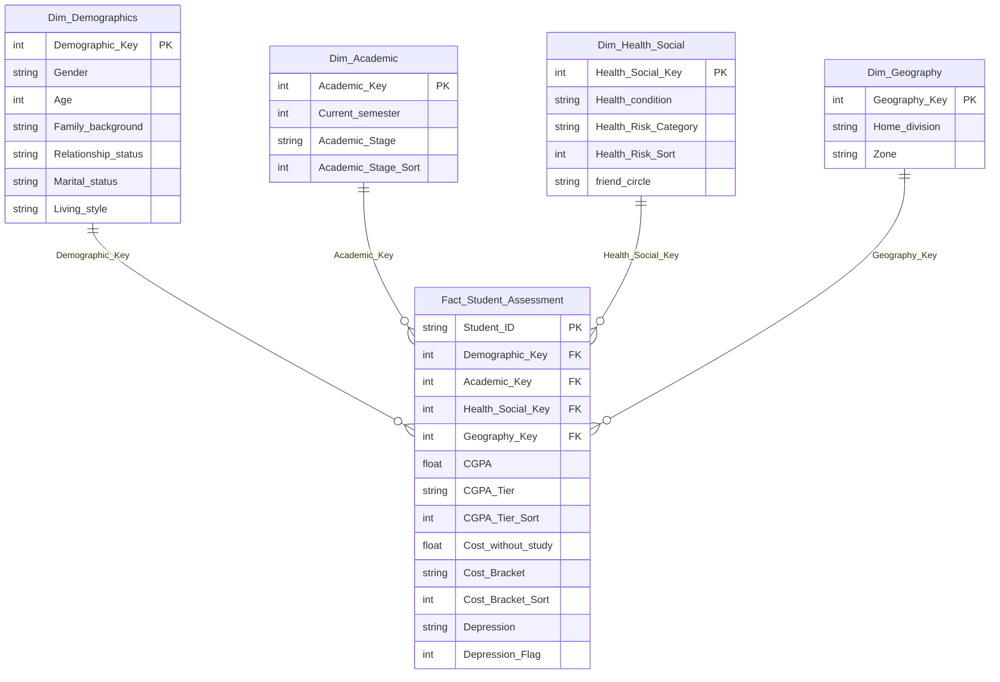

# Power BI Data Model & Architecture Guide

## 1. Architectural Overview: Flat Table vs. Star Schema

As a future Power BI Developer transitioning from Support Engineering, one of the most common mistakes candidates make in technical interviews is leaving data as **a single wide flat table**.

| Architectural Dimension | Flat Table (Beginner) | Star Schema (Enterprise Power BI) |
| :--- | :--- | :--- |
| **Data Engine Performance** | Redundant string columns consume excessive RAM in the VertiPaq engine. | Dimension tables deduplicate text; Fact table stores lean integers and surrogate keys. |
| **Filter Context & DAX** | `CALCULATE` and `ALL` filters must scan wide tables, risking subtle filter-bleed bugs. | Clear 1-to-Many (`1:*`) one-way relationships guarantee predictable filter propagation. |
| **Scalability** | Adding new surveys or semesters duplicates customer/student attributes. | Incremental refresh and new transaction dates attach cleanly to existing dimensions. |
| **UX & Field List** | 25+ columns cluttering a single visual pane, confusing report builders. | Logical folders: Demographics, Academic, Health, Geography, and a dedicated `_Measures` table. |

---

## 2. Dimensional Model Entity-Relationship Diagram

---

## 3. Relationship Specifications

1. **`Dim_Demographics[Demographic_Key]` $\to$ `Fact_Student_Assessment[Demographic_Key]`**
   - **Cardinality**: 1-to-Many (`1:*`)
   - **Cross-filter direction**: Single (Dimension filters Fact)
   - **Enforce Referent Integrity**: Enabled

2. **`Dim_Academic[Academic_Key]` $\to$ `Fact_Student_Assessment[Academic_Key]`**
   - **Cardinality**: 1-to-Many (`1:*`)
   - **Cross-filter direction**: Single
   - **Enforce Referent Integrity**: Enabled

3. **`Dim_Health_Social[Health_Social_Key]` $\to$ `Fact_Student_Assessment[Health_Social_Key]`**
   - **Cardinality**: 1-to-Many (`1:*`)
   - **Cross-filter direction**: Single
   - **Enforce Referent Integrity**: Enabled

4. **`Dim_Geography[Geography_Key]` $\to$ `Fact_Student_Assessment[Geography_Key]`**
   - **Cardinality**: 1-to-Many (`1:*`)
   - **Cross-filter direction**: Single
   - **Enforce Referent Integrity**: Enabled

---

## 4. Crucial "Sort By Column" Settings in Power BI Desktop

If you do not configure **Sort by Column**, Power BI sorts textual categories alphabetically (e.g. `Early Stage` will sort after `Academic Stage`, or `High` will sort before `Low`). This looks unprofessional in a portfolio.

Configure the following column properties in **Model View**:

1. Select `CGPA_Tier` $\to$ Set **Sort by column** = `CGPA_Tier_Sort`
2. Select `Academic_Stage` $\to$ Set **Sort by column** = `Academic_Stage_Sort`
3. Select `Cost_Bracket` $\to$ Set **Sort by column** = `Cost_Bracket_Sort`
4. Select `Health_Risk_Category` $\to$ Set **Sort by column** = `Health_Risk_Sort`

> [!TIP]
> Always hide the `_Sort` columns in the Report View (`IsHidden = True`) so end-users never see redundant helper columns in the field picker.
