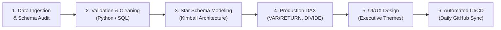

# 💼 Enterprise Power BI & Business Intelligence Portfolio Hub

> **Author**: Aspiring Power BI Developer / BI Analyst (Transitioning from Support Engineering)  
> **Repository Purpose**: Multi-project enterprise analytics portfolio featuring robust data pipelines, dimensional modeling, production-grade DAX, and automated CI/CD synchronization.

---

## 🌟 Transition Story & Competitive Advantage

Transitioning from **Support Engineering to Power BI Developer** brings a unique and highly sought-after skill set to analytics teams:

1. **Root-Cause Diagnostic Instinct**: In support, you never trust surface symptoms. In BI, this means rigorous data profiling, boundary testing, and anomaly detection before building a single visual.
2. **Defensive Modeling & Error Handling**: From handling production outages, I design dashboards that never crash on division-by-zero, unexpected blanks, or schema drift.
3. **User-Centric Visual Communication**: Support engineers communicate complex technical issues to non-technical stakeholders daily. My dashboards prioritize visual hierarchy, fast time-to-insight, and clear operational next steps.

---

## 📁 Portfolio Projects Index

| Project # | Project Title | Business Domain | Key Stack | Live Assets | Status |
| :---: | :--- | :--- | :--- | :--- | :---: |
| **01** | [Student Depression Analytics & Early-Warning Suite](./Project-01_Student_Depression_Analysis/) | Higher Education / Clinical Health | Python, SQLite, Power Query, DAX, Power BI | [Folder](./Project-01_Student_Depression_Analysis/) | `Complete` ✅ |
| **02** | *Enterprise Sales & Margin Optimization* (Upcoming) | E-Commerce / Retail | SQL, Star Schema, Advanced DAX, Power BI | *Queued* | `In Progress` ⏳ |
| **03** | *IT Service Desk & SLA Performance Analytics* (Upcoming) | IT Operations & ITSM | DirectQuery, Python ETL, Power BI | *Queued* | `Planned` 📅 |

---

## 🏗️ End-to-End Analytics Workflow Standards

For **every project** in this portfolio, we adhere to enterprise data lifecycle standards:



---

## 🤖 Continuous GitHub Activity & Automation

This repository is equipped with an automated **GitHub Actions CI/CD Pipeline** (`.github/workflows/daily-activity.yml`) that:
- Runs daily at `06:00 UTC`.
- Validates the database schemas and recalculates core business KPIs.
- Updates [`PORTFOLIO_METRICS.md`](./PORTFOLIO_METRICS.md) and [`portfolio_activity_log.json`](./portfolio_activity_log.json).
- Commits and pushes verified health status directly to GitHub, maintaining consistent daily contribution activity.

---

## 📂 Repository Directory Layout

```
d:\PowerBi Projects/
├── .github/
│   └── workflows/
│       └── daily-activity.yml                  # GitHub Actions continuous automation
├── Project-01_Student_Depression_Analysis/
│   ├── data/
│   │   ├── raw/                                # Raw survey dataset (CSV & XLSX)
│   │   └── processed/                          # Enriched dataset, SQLite DB, Data Dictionary
│   ├── sql/                                    # DDL schemas, audits, & analytical queries
│   ├── scripts/                                # Python automated validation pipeline
│   ├── power_bi/                               # Power Query M code, DAX measures, Data Model
│   ├── documentation/                          # UI/UX design specs & Interview Q&A guide
│   └── README.md                               # Project 1 Showcase
├── scripts/
│   └── daily_portfolio_sync.py                 # Automated daily portfolio refresh engine
├── portfolio_activity_log.json                 # Rolling automated activity audit trail
├── PORTFOLIO_METRICS.md                        # Auto-generated portfolio health scorecard
└── README.md                                   # Root Portfolio Hub documentation
```

---

## 📬 Contact & Portfolio Links
- **LinkedIn**: *[Add your LinkedIn profile link]*
- **Portfolio Website**: *[Add your personal portfolio website link]*
- **GitHub**: *[Add your GitHub profile link]*
